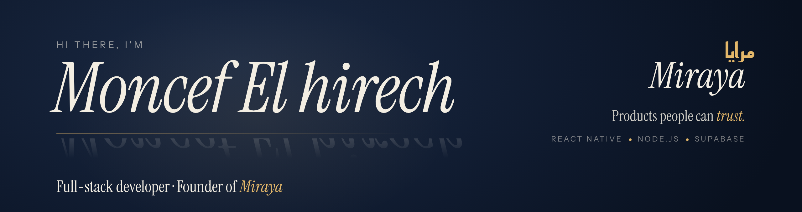

  

  
  
  

---

### 👋 About me

I'm a **self-taught full-stack developer** from Meknès, Morocco. I learned by building real products, reading the docs and debugging problems until they made sense.

I'm the founder of **[Miraya](https://github.com/miraya-dev) (مرايا)**, my independent product studio. Every product I design, build and ship lives there.

- 🛠️ I build **mobile apps** with React Native & Expo, and **backends** with Node.js, PostgreSQL & Supabase
- 🔐 I care about **security**: Row Level Security, database triggers, auth flows and complex business logic
- 🤖 I use AI (Claude, Cursor) to ship faster, but I never copy-paste blindly
- 🌍 Open to **remote & freelance** work and an **Ausbildung als Fachinformatiker** in Germany 🇩🇪
- 🗣️ Arabic · French · English · German

---

### 🚀 Featured projects

| Project | What it does | Stack |
|---|---|---|
| 🛡️ **AMANE** | Community anti-scam platform for the MENA region: check a phone number, bank account or name, report fraud with proof, and moderate reports through an admin dashboard with a public appeals system | React Native · Expo · Node.js · Supabase |
| 📄 **[Sira](https://sira-eta.vercel.app)** | Turns your story into a professional CV and portfolio page, with 30 hand-built designs | Web · Vercel |
| 🏥 **Clinic management system** | Custom system built for a dermatology clinic in Rabat | Full-stack |

➡️ More at **[github.com/miraya-dev](https://github.com/miraya-dev)**

---

### 🧰 Tech stack

  
  
  
  
  
  
  
  

---

### 📊 GitHub stats

  
  

---

<i>Building products people can trust.</i> 🪞

